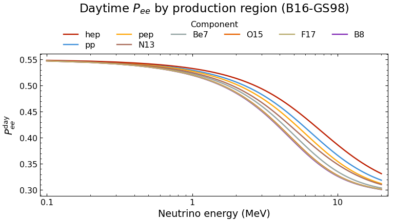
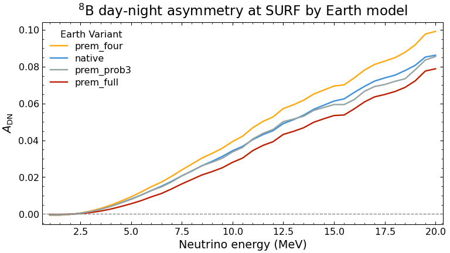
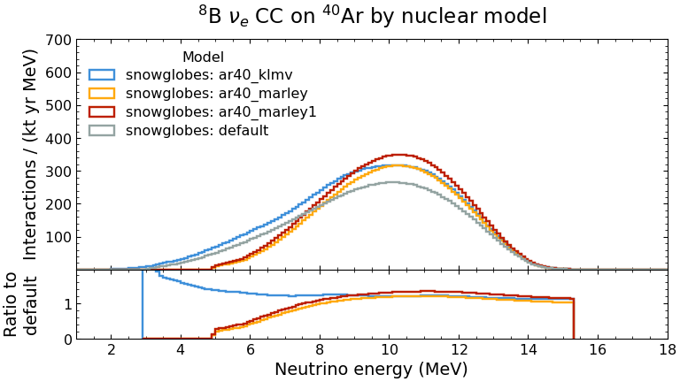
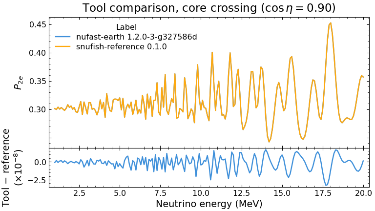

# SNUfish

**Calculator: [mantheys.github.io/snufish](https://mantheys.github.io/snufish/)**

Community benchmarks of solar neutrino tools. Every tool computes the same
fixed problem; SNUfish validates the outputs and plots them side by side
with [plotipus](https://github.com/mantheys/plotipus), so users can see
which tools agree, where and by how much.

(The name: the Solar Neutrino Unit, the Sun, nu, and a fish to swim with
plotipus.)

## Results so far

<table>
<tr>
<td width="50%">
<picture>
  <source media="(prefers-color-scheme: dark)" srcset="docs/images/dark/components.png">
  
</picture>
<b>MSW in the Sun (B2).</b> Daytime P<sub>ee</sub> for each flux component of
B16-GS98, averaged over its production region: 0.544 for pp, 0.326 for
<sup>8</sup>B at 10 MeV.
</td>
<td width="50%">
<picture>
  <source media="(prefers-color-scheme: dark)" srcset="docs/images/dark/adn_models.png">
  
</picture>
<b>Day-night asymmetry (B2 × B3).</b> <sup>8</sup>B at SURF (DUNE),
2(N−D)/(N+D): 2.9 % to 4.0 % over 5–15 MeV depending on the Earth model.
</td>
</tr>
<tr>
<td width="50%">
<picture>
  <source media="(prefers-color-scheme: dark)" srcset="docs/images/dark/ar40_b8_models.png">
  
</picture>
<b>Rates (B4 → B5).</b> <sup>8</sup>B ν<sub>e</sub> CC interactions on
<sup>40</sup>Ar per kton-year for four nuclear models: 1,566 to 1,922;
the cross sections differ by a factor 5–7 at 5 MeV.
</td>
<td width="50%">
<picture>
  <source media="(prefers-color-scheme: dark)" srcset="docs/images/dark/tools.png">
  
</picture>
<b>Tool comparison (B3).</b> NuFast-Earth against the SNUfish reference
through the core: they agree to 6 × 10<sup>−8</sup>. The spread in
predictions comes from the inputs, not the solvers.
</td>
</tr>
</table>

Across the ten solar models the <sup>8</sup>B CC rate on argon spans ±16 %,
comparable to the spread between nuclear models of the cross section. As a
check against data: the folded pp elastic-scattering rate (B16-GS98) is 136
interactions per day per 100 t of scintillator electrons; Borexino measured
134 ± 10. Figures are regenerated with `python scripts/readme_images.py`
after `snufish build`.

## Benchmarks

| id | Compares |
|---|---|
| **B1_ssm** | Ten standard solar models (B16, BS05, B23 / SF-III) in one format: fluxes, electron density, production profiles |
| **B2_sun** | Mass-eigenstate fractions leaving the Sun for every B1 model, averaged per flux component |
| **B3_earth** | P(ν<sub>i</sub> → ν<sub>e</sub>) through the Earth on PREM variants; night averages per detector site |
| **B4_xsec** | Cross sections per detection channel; nuclear models of <sup>40</sup>Ar as variants |
| **B5_rates** | Interactions per kton-year by solar model, detector, channel and flux component, for every B4 model |

B2 and B3 combine into day and night P<sub>ee</sub> and the day-night
asymmetry. Specs, grids and open questions:
[benchmarks/README.md](benchmarks/README.md). Tools so far: the SNUfish
reference solvers, [NuFast-Earth](https://github.com/PeterDenton/NuFast-Earth)
(B2, B3) and [SNOwGLoBES](https://github.com/SNOwGLoBES/snowglobes) (B4); see
[catalogue/tools](catalogue/tools).

## Analyses on top of the benchmarks

- `snufish scan`: the observables that separate the solar and reactor
  determinations of Delta m^2_21 (8B day-night asymmetry of the
  elastic-scattering rate above a recoil threshold, the slope and shape of
  the daytime P_ee) against Delta m^2_21 and at every parameter set of
  `reference/oscillation/parameter_sets.yaml` (NuFIT 6.0, JUNO 2025,
  KamLAND, SK solar fits), for each Earth model, compared with the
  measurements in `reference/measurements/solar.yaml`. Plots:
  `plotipus run scan`.
- `snufish budget`: uncertainty propagation to the 8B rates and the
  day-night asymmetry. Solar fluxes (with the B23 correlations, or the SNO
  neutral-current 8B flux) and oscillation parameters are sampled; nuclear
  model, ES radiative corrections, Earth model and solar model are reported
  as model ranges, never folded into a sigma. Plots: `plotipus run budget`.

Both use the solvers the benchmarks validate (the B2 adiabatic reference,
NuFast-Earth for the night: `make` in `contributions/nufast-earth/scripts`),
through `snufish.engine`: the folding of fluxes, probabilities and cross
sections and the uncertainty budget, in NumPy only.

## The web page

**[mantheys.github.io/snufish](https://mantheys.github.io/snufish/)**: a static site (plain JavaScript, no server) on top of the same engine: a home
page crediting every experiment, model and tool used (`index.html`), and the
calculator (`rates.html`): choose the result (rate or day-night asymmetry),
oscillation parameters, solar model and flux components, site and Earth
model (optionally at the real Earth–Sun distance: [cross-checks](docs/crosschecks.md#earthsun-distance)), interaction (target, channel, cross-section model) and detector
(threshold, resolution, efficiency, exposure and detector uncertainties; a
Super-K IV preset from its published values; or an imported smearing matrix
and efficiency curve, read in the browser and never uploaded), each step with links
to its sources; get the spectrum in observed energy (ES: electron kinetic
energy; CC: E_nu - Q), the distribution of the sampled values and the error
budget.
It opens in under a second and recomputes in ~50 ms. Its figures use
plotipus's palette and frame; "Render with plotipus" draws the plotipus
figures themselves in the browser (Pyodide in a background worker, loaded on
first use: ~15 s the first time, ~2 s after). "Download" gives the result as
Parquet with a plotipus command list and colour registry (`plotipus run
app`) and the figures.

`web/engine.js` is a port of `snufish.engine`: `tests/test_web_engine.py`
runs both on the same tables and random draws and requires agreement to
1e-9 (it is ~1e-14). The Sun and Earth solvers are replaced by tables of
their results on a (sin^2 theta12, Delta m^2_21) grid, which reproduce them
to 2e-4 for rates and 1% for the day-night asymmetry (3e-4 absolute;
`tests/test_engine.py`, or `snufish budget --tables build/app`).

```bash
snufish export-app --out build/app      # tables, ~3 min on 8 cores
python web/build.py --out build/site    # page + tables + plotipus wheel (--plotipus ../plotipus)
python -m http.server -d build/site     # open http://localhost:8000
bash web/deploy.sh                      # build and publish to GitHub Pages (gh-pages branch)
```

## Layout

```
benchmarks/<id>/spec.yaml        fixed inputs, grids and checks of one benchmark
catalogue/tools/<tool>.yaml      tool entries
contributions/<tool>/<benchmark>/<tool_version>/
    data.parquet                 long format, columns set by the spec
    meta.yaml                    provenance (tool, version, commit, settings, ...)
contributions/<tool>/scripts/    how a tool's contribution is produced
reference/                       shared inputs (solar model, flux shapes), with provenance
input/plots/<list>_scripts.txt   plotipus command lists
src/snufish/                     validator, builder, reference solvers, engine
web/                             the web page (static; engine.js ports snufish.engine)
```

## Use

Install into a virtual environment; the `snufish` command exists only while
it is active (or call `.venv/bin/snufish`):

```bash
python -m venv .venv && source .venv/bin/activate      # once; then activate in each new shell
pip install -e ".[dev,plots]"
snufish validate                 # check every contribution against its spec
snufish build                    # validated contributions -> build/data/*.parquet for plotipus
plotipus run b3                  # figures in output/plots (also b2, b45)
pytest
```

Contributions and build products are Parquet: data only, safe to share and
to load from others.

`snufish build --extra ../some-overlay/contributions` adds contributions kept
outside this repository (e.g. results not yet public) to a local build.

## Contributing

See [docs/CONTRIBUTING.md](docs/CONTRIBUTING.md).
