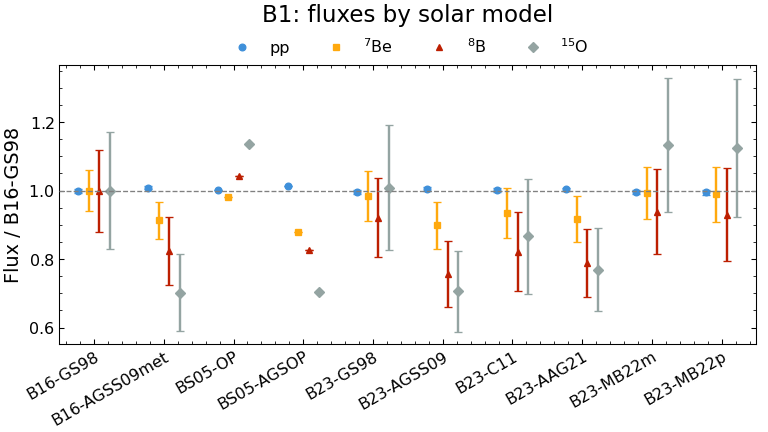
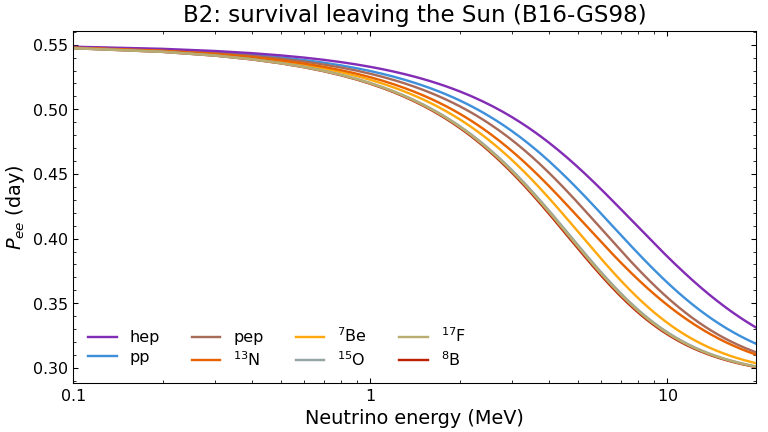
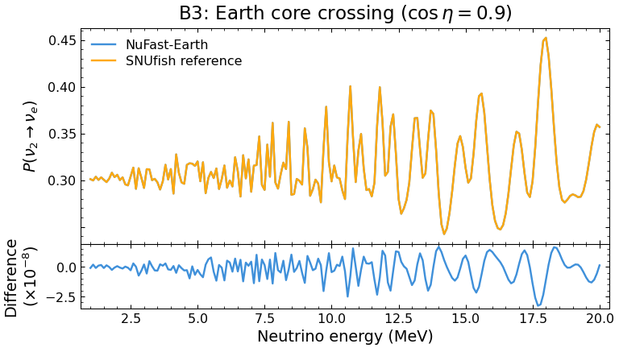
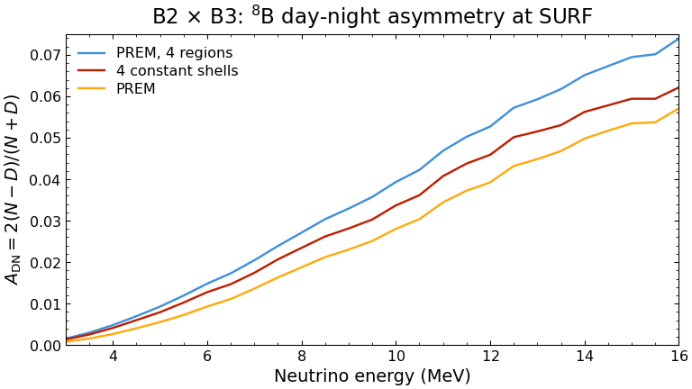
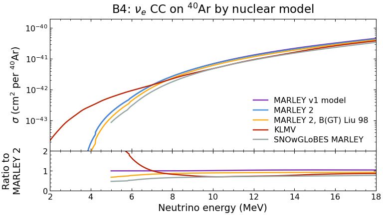
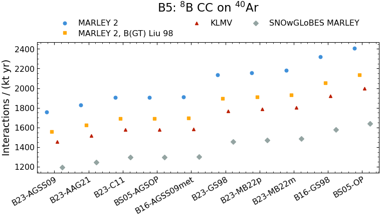

# SNUfish

**Calculator: [mantheys.github.io/snufish](https://mantheys.github.io/snufish/)** ·
**Documentation: [docs/](docs/README.md)**

Community benchmarks of solar neutrino tools. Every tool computes the same
fixed problem; SNUfish validates the outputs and plots them side by side
with [plotipus](https://github.com/mantheys/plotipus), so users can see
which tools agree, where and by how much. On top of the validated solvers it
computes interaction rates, day-night asymmetries and their uncertainty
budgets, from the command line or in a static web page.

(The name: the Solar Neutrino Unit, the Sun, nu, and a fish to swim with
plotipus.)

## Goals

1. **Separate the solver from the inputs.** A solar neutrino prediction
   chains a solar model, MSW propagation in the Sun, propagation through the
   Earth, a cross section and a detector response. When two calculations
   disagree it is rarely clear which link is responsible. SNUfish fixes every
   input of each link (grids, oscillation parameters, matter profiles,
   constants) in a benchmark spec, so contributions differ only by the tool.
2. **Show the spread that matters.** Each benchmark also carries model
   variants (ten solar models, four Earth models, eight ν<sub>e</sub>–<sup>40</sup>Ar
   nuclear models, three ES cross-section treatments), so the difference
   between tools can be read next to the difference between physics inputs.
3. **Every number traceable.** Every input file records its paper, table or
   figure, retrieval date and method (table or digitised); every
   contribution records the tool version, commit, command and settings.
   Published numbers are recomputed with the inputs their paper states
   ([docs/crosschecks.md](docs/crosschecks.md)).
4. **Uncertainties kept honest.** Sampled uncertainties (oscillation
   parameters, solar fluxes with their correlations, statistics, detector
   scale and resolution) are reported as a σ; model choices (nuclear model,
   radiative corrections, Earth model, solar model) are reported as ranges
   and never folded into a σ.
5. **Open and cheap to use.** Contributions and products are Parquet (data
   only); the calculator is a static page that runs the same engine in the
   browser, with no server.

## Use cases

| You are… | SNUfish gives you |
|---|---|
| **A tool developer** (oscillation, cross-section or rate code) | A fixed problem to run, a validator with physics checks (unitarity, vacuum limit at the horizon, normalisation), and plots of your tool against the others and the reference solvers. See [docs/CONTRIBUTING.md](docs/CONTRIBUTING.md). |
| **A detector physicist** planning or checking a solar analysis | Rates and spectra in observed energy for water, argon, scintillator and heavy water, with threshold, resolution, efficiency (or an imported smearing matrix and efficiency curve), exposure and detector uncertainties; presets for Super-K IV, Hyper-K, DUNE, SNO, Borexino and JUNO. |
| **A phenomenologist** asking what separates solar and reactor Δm²<sub>21</sub> | `snufish scan`: the <sup>8</sup>B day-night asymmetry, the slope and curvature of the daytime P<sub>ee</sub> and the upturn, against Δm²<sub>21</sub> and at each published parameter set, next to the measurements. |
| **Anyone quoting a rate** | An error budget split into sampled sources and model ranges (`snufish budget`, or the calculator), so the dominant uncertainty and the model dependence are visible separately. |
| **A reviewer or student** | A one-click reproduction of published numbers (Borexino, Super-K, SNO, JUNO, BKS) in the calculator, each linked to its paper, and the official figures recomputed. |

## Results so far

One figure per stage of the chain, from the solar model to the rate in a
detector.

<table>
<tr>
<td width="50%">
<picture>
  <source media="(prefers-color-scheme: dark)" srcset="docs/images/dark/b1_fluxes.png">
  
</picture>
<b>B1 · Solar models.</b> The composition moves the <sup>8</sup>B flux from
0.76 to 1.04 × B16-GS98 and CNO by −30 % to +14 %; pp stays within 1.5 %.
</td>
<td width="50%">
<picture>
  <source media="(prefers-color-scheme: dark)" srcset="docs/images/dark/b2_pee.png">
  
</picture>
<b>B2 · MSW in the Sun.</b> Daytime P<sub>ee</sub> per component, averaged over
where it is produced: 0.54 at low energy; at 10 MeV 0.326 for <sup>8</sup>B,
0.386 for hep (made further out, at lower density).
</td>
</tr>
<tr>
<td width="50%">
<picture>
  <source media="(prefers-color-scheme: dark)" srcset="docs/images/dark/b3_tools.png">
   nue) through the Earth's core for NuFast-Earth and the SNUfish reference, with their difference at the 1e-8 level.">
</picture>
<b>B3 · Earth crossing.</b> NuFast-Earth against the exact SNUfish
reference through the core: they agree to a few 10<sup>−8</sup>. Differences in
predictions come from the inputs, not the solvers.
</td>
<td width="50%">
<picture>
  <source media="(prefers-color-scheme: dark)" srcset="docs/images/dark/b23_adn.png">
  
</picture>
<b>B2 × B3 · Day-night asymmetry.</b> <sup>8</sup>B at SURF (DUNE), 10 MeV:
2.8 % with full PREM, 3.4–3.9 % with the crustless models: the density under
the detector matters most.
</td>
</tr>
<tr>
<td width="50%">
<picture>
  <source media="(prefers-color-scheme: dark)" srcset="docs/images/dark/b4_ar40.png">
  
</picture>
<b>B4 · Cross sections.</b> ν<sub>e</sub> CC on <sup>40</sup>Ar: the measured
B(GT) set moves MARLEY 2 by 8–23 %; SNOwGLoBES's MARLEY table (no Coulomb
factor) is 30 % low at 10 MeV, KLMV 66 % high at 6 MeV.
</td>
<td width="50%">
<picture>
  <source media="(prefers-color-scheme: dark)" srcset="docs/images/dark/b5_rates.png">
  
</picture>
<b>B5 · Rates.</b> <sup>8</sup>B CC on <sup>40</sup>Ar per kt·yr: the solar
model moves it by ±16 % (MARLEY 2: 1,757 to 2,409), the nuclear model by
up to 47 % (1,581 to 2,321 for B16-GS98).
</td>
</tr>
</table>

As a check against data: the folded pp elastic-scattering rate (B16-GS98) is
136 interactions per day per 100 t of scintillator electrons; Borexino
measured 134 ± 10 ([more cross-checks](docs/crosschecks.md)). Figures are
regenerated with `python scripts/readme_images.py` after `snufish build`.

## Benchmarks

| id | Compares |
|---|---|
| **B1_ssm** | Ten standard solar models (B16, BS05, B23 / SF-III) in one format: fluxes, electron density, production profiles |
| **B2_sun** | Mass-eigenstate fractions leaving the Sun for every B1 model, averaged per flux component |
| **B3_earth** | P(ν<sub>i</sub> → ν<sub>e</sub>) through the Earth on PREM variants; night averages per detector site |
| **B4_xsec** | Cross sections per detection channel; nuclear models of <sup>40</sup>Ar as variants |
| **B5_rates** | Interactions per kton-year by solar model, detector, channel and flux component, for every B4 model |

B2 and B3 combine into day and night P<sub>ee</sub> and the day-night
asymmetry. Tools so far: the SNUfish reference solvers,
[NuFast-Earth](https://github.com/PeterDenton/NuFast-Earth) (B2, B3),
[SNOwGLoBES](https://github.com/SNOwGLoBES/snowglobes) (B4, B5) and
[MARLEY](https://github.com/MARLEY-MC/marley) (B4); see
[catalogue/tools](catalogue/tools). Details of every benchmark:
[docs/benchmarks.md](docs/benchmarks.md).

## Quick start

Install into a virtual environment; the `snufish` command exists only while
it is active (or call `.venv/bin/snufish`):

```bash
git clone --recurse-submodules https://github.com/mantheys/snufish && cd snufish
python -m venv .venv && source .venv/bin/activate      # once; then activate in each new shell
pip install -e ".[dev,plots]"
snufish validate                 # check every contribution against its spec
snufish build                    # validated contributions -> build/data/*.parquet for plotipus
plotipus run b3                  # figures in output/plots (also b1, b2, b45)
pytest
```

The analyses below need the NuFast-Earth driver for the night:
`make -C contributions/nufast-earth/scripts`.

```bash
snufish scan                     # solar observables against Delta m^2_21; plotipus run scan
snufish budget                   # error budget of the 8B rates and A_DN; plotipus run budget
snufish export-app --out build/app      # tables of the web page, ~3 min on 8 cores
snufish export-sections                 # data of the benchmark pages (benchmarks.html)
python web/build.py --out build/site    # page + tables + plotipus wheel (--plotipus ../plotipus)
python -m http.server -d build/site     # open http://localhost:8000
```

Every command and option, the Python engine API and the calculator are
described in [docs/usage.md](docs/usage.md).

## The web page

**[mantheys.github.io/snufish](https://mantheys.github.io/snufish/)**: a
static site (plain JavaScript, no server) on top of the same engine. The
calculator takes six steps (result; oscillation parameters; Sun; Earth;
interaction; detector), each with links to its sources (the Earth step can
include the real Earth–Sun distance:
[cross-checks](docs/crosschecks.md#earthsun-distance)), and returns the
spectrum in observed energy, the distribution of the sampled values and the
error budget, in ~50 ms. "Result Templates" sets every step to a
paper's inputs. "Render with plotipus" draws the plotipus figures in the
browser (Pyodide); "Download" gives Parquet, figures and a plotipus command
list. `web/engine.js` agrees with `snufish.engine` to ~1e-14
(`tests/test_web_engine.py`).

## Documentation

| Page | Contents |
|---|---|
| [docs/architecture.md](docs/architecture.md) | How the pieces fit: specs, contributions, validation, build, engine, web page |
| [docs/benchmarks.md](docs/benchmarks.md) | B1–B5 in detail: inputs, grids, quantities, variants, checks, products |
| [docs/methods.md](docs/methods.md) | The physics and numerics: Sun, Earth, exposure, cross sections, rates, detector response, uncertainties, interpolation tables |
| [docs/sources.md](docs/sources.md) | Every input with its source: solar models, spectra, oscillation sets, Earth models, sites, cross sections, detectors, measurements, tools |
| [docs/usage.md](docs/usage.md) | Command line, Python API, plotipus lists, output frames, the calculator, deployment |
| [docs/crosschecks.md](docs/crosschecks.md) | Published numbers recomputed: reproduced, not reproduced, measurements |
| [docs/status.md](docs/status.md) | What is missing, known limitations and open questions |
| [docs/CONTRIBUTING.md](docs/CONTRIBUTING.md) | Contributing a tool's results |

## Layout

```text
benchmarks/<id>/spec.yaml        fixed inputs, grids and checks of one benchmark
catalogue/tools/<tool>.yaml      tool entries
contributions/<tool>/<benchmark>/<tool_version>/
    data.parquet                 long format, columns set by the spec
    meta.yaml                    provenance (tool, version, commit, settings, ...)
contributions/<tool>/scripts/    how a tool's contribution is produced
reference/                       shared inputs (solar models, spectra, parameter sets, measurements), with provenance
input/plots/<list>_scripts.txt   plotipus command lists
scripts/                         import of solar models, cross-checks, README figures
src/snufish/                     validator, builder, reference solvers, engine
web/                             the web page (static; engine.js ports snufish.engine)
docs/                            documentation
```

Contributions and build products are Parquet: data only, safe to share and
to load from others. `snufish build --extra ../some-overlay/contributions`
adds contributions kept outside this repository (e.g. results not yet
public) to a local build.

## Contributing

See [docs/CONTRIBUTING.md](docs/CONTRIBUTING.md). Open work is listed in
[docs/status.md](docs/status.md).

## Licence

Code: MIT ([LICENSE](LICENSE)). Contributions carry their own licence in
`meta.yaml` (CC-BY-4.0 so far); reference data keep the licence of their
source ([docs/sources.md](docs/sources.md)).
